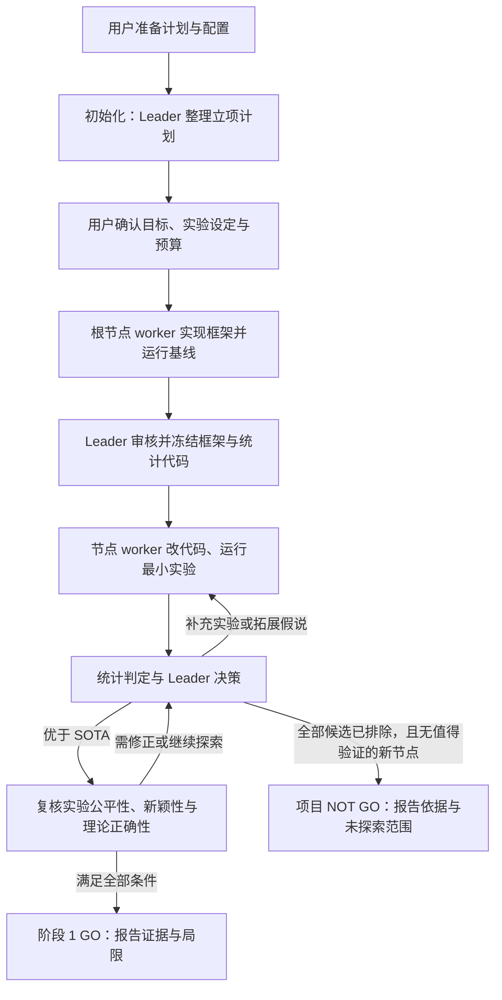

# research-tree

在 **Claude Code** 或 **Codex CLI** 中运行多角色 ML 研究：从研究计划出发，建立假说树，用最小实验筛选方法，并保留可追溯的结果、文档与决策。

当前工作流聚焦**阶段 1：低成本验证与 GO / NOT GO 判断**。进入阶段 2 的大规模实验前，由用户确定范围与预算。

两端共用研究规则、数据库、配置和页面生成器；分别提供适合各自宿主的命令、代理会话与界面。

[安装](#安装) · [快速开始](#快速开始) · [研究工作流](#研究工作流) · [日常使用](#日常使用) · [项目配置](#项目配置) · [源码与发布](#源码与发布) · [开发与验证](#开发与验证)

## 安装

### 环境要求

- 对应的宿主 CLI。Codex 版已在 **CLI 0.160.0** 上验证，运行研究前需完成登录。
- [uv](https://docs.astral.sh/uv/)；`prepare` 用它建立项目的 Python 环境并安装依赖。
- Codex 适配层使用 POSIX 环境和 Python 3。`prepare` 只需要 POSIX shell 和 uv，不依赖 Python 或已有项目。

安装包包含完整插件代码、规则、模板和依赖声明；不包含宿主 CLI、虚拟环境或离线依赖包。

### 使用发布包

选择对应 ZIP 并解压，然后在终端执行：

| 宿主 | 发布包 | 解压后的 marketplace 根目录 |
|---|---|---|
| Claude Code | `research-tree-claude-<版本>.zip` | `research-tree-claude/` |
| Codex CLI | `research-tree-codex-<版本>.zip` | `research-tree-codex/` |

**Claude Code**

```bash
claude plugin marketplace add /absolute/path/to/research-tree-claude
claude plugin install research-tree@research-tree
```

**Codex CLI**

```bash
codex plugin marketplace add /absolute/path/to/research-tree-codex
codex plugin add research-tree@research-tree
```

### 使用本地源码构建的版本

在仓库根目录构建两端安装包。共享集群上应在计算节点执行构建。

```bash
python3 scripts/build_plugins.py --target all
```

生成的目录已经包含完整插件，**无需解压**：

| 用途 | Claude Code | Codex CLI |
|---|---|---|
| 添加 marketplace 时使用 | `dist/claude/` | `dist/codex/` |
| 完整插件所在目录 | `dist/claude/plugins/research-tree/` | `dist/codex/plugins/research-tree/` |

安装命令与发布包相同，将路径换成 `dist/claude` 或 `dist/codex` 的绝对路径即可。Claude 也可仅在一次会话中试用：

```bash
claude --plugin-dir /absolute/path/to/research-agent/dist/claude/plugins/research-tree
```

`claude-mod/` 和 `codex-plugin/` 只存放适配层源码，不能直接作为完整插件安装。修改源码后重新构建，再更新已安装的插件。

## 快速开始

以下命令在**研究项目目录的宿主会话中**输入，作用于该目录。Claude Code 使用 `/research-tree`，Codex 使用 `$research-tree`。

### 1. 准备项目目录

| Claude Code | Codex CLI |
|---|---|
| `/research-tree prepare` | `$research-tree prepare` |

`prepare` 依次完成三件事，已有文件不会覆盖：

1. 用 uv 把当前目录建成项目环境（`uv init . --python 3.13`，已有 `pyproject.toml` 时跳过），并安装共享工具所需依赖；
2. 生成研究计划模板 `plan.md`；
3. 生成带注释的默认配置 `research-tree.yaml`。

| 选项 | 用途 |
|---|---|
| `--python 3.13` | 建立新环境时使用的 Python 版本，默认 `3.13` |
| `--update-uv` | 先运行 `uv self update` |

### 2. 填写计划与配置

`plan.md` 按章节填写：**研究目标**和**初始假说**必填；期望使用的模型、训练与评测数据集（写 Hugging Face Hub 上的正式 ID，数据集加 config 与 split）、基线，评测与指标，实验范围，验收要求等各节默认写着“由 RLD 决定。”，保留时由 Leader 在立项计划中提出方案，经你确认后执行。插件会保留计划原文，Leader 再将其整理为可执行的立项计划。

在 `research-tree.yaml` 中设置开发与实验平台、资源预算、阶段1门槛和子代理模型；配置项见[项目配置](#项目配置)。

### 3. 初始化项目

| Claude Code | Codex CLI |
|---|---|
| `/research-tree init` | `$research-tree init` |

初始化读取 `plan.md` 和本目录的 `research-tree.yaml`，建立数据库和文档目录，并进入立项规划。**此时还不会启动研究 worker。**

| 选项 | 用途 |
|---|---|
| `计划.md` | 使用 `plan.md` 以外的计划文件 |
| `--config 配置.yaml` | 使用本目录 `research-tree.yaml` 以外的配置文件（复制为 `research-tree.yaml`） |
| `--id 项目ID` | 指定项目 ID；默认从项目名称推导 |

Codex 的研究运行需要审阅并信任插件 hooks。其安装、会话恢复和权限说明见 [Codex 插件说明](codex-plugin/research-tree/README.md)。

### 4. 审阅并确认立项计划

Leader 会整理研究目标、最小实验设定、初始假说、基线任务和预算，并向你请求确认。审阅后可以在研究对话窗口或主会话中明确同意，也可以输入：

| Claude Code | Codex CLI |
|---|---|
| `/research-tree confirm` | `$research-tree confirm` |

确认后，插件登记当时的配置版本，Leader 才能指派 worker，先实现根节点的实验框架与基线。

## 研究工作流

### 角色如何协作

| 角色 | 主要职责 |
|---|---|
| **用户** | 提供目标和约束，确认立项计划，决定预算、权限与范围变更 |
| **UI：研究对话窗口** | 澄清需求、记录用户原话、解释已有结果，将问题和指令转交 Leader |
| **RLD：Research Leader** | 当前主会话中的唯一 Leader；规划研究、分配任务、评审证据、拓展或剪枝假说树 |
| **worker** | 每个节点绑定一个固定身份；负责该节点的代码、实验、验证和证据交付 |

用户也可以直接在主会话下达指令，无需到 UI 重复授权。UI 负责沟通，实验调度与研究决策由 Leader 执行。

### 从计划到结论



| 阶段 | 发生什么 | 留下什么证据 |
|---|---|---|
| **立项规划** | Leader 阅读计划、检索相关研究，建立初始假说与根节点任务，向用户请求确认 | 目标、最小实验设定、相关研究、立项计划 |
| **建立基线** | 根节点 worker 实现训练、评测与统计代码，实际运行统一 seed 的 SOTA 基线；Leader 审核后冻结；立项时登记指标规范（方向、单位、最小实际收益、保护阈值）与实验协议（评测类型、配对字段） | 框架版本、基线运行、原始指标和统计结果 |
| **验证假说** | 每个节点的 worker 在自己的分支或 worktree 中实现改动，按预算运行筛选实验 | 代码版本、实验设定、run/job ID、结果与交付文档 |
| **比较与迭代** | 运行结果经 manifest 导入；接口按指标规范从 run 重算均值、SD、与父节点和 SOTA 的配对效应、门槛与保护指标，记为版本化的 evaluation（调用者不提供权威数字）；Leader 决定补充 seed、拓展或剪枝 | evaluation、实验判定、节点状态和决定理由 |
| **复核与结项** | 优于 SOTA 后复核公平性、新颖性与理论正确性；满足条件时作出 GO 或 NOT GO 判断 | 复核记录、最终报告、进度页面与未完成项 |

### 假说树如何组织

根节点只存放实验框架、统计代码和基线；初始假说彼此平级。验证完成且可拓展的节点，才能继续派生子节点。

```text
根节点：框架与 baselines                   ← worker/root
├── 初始假说 A                            ← 独立 worker
│   └── A 的后续改进（A 验证后再创建）     ← 独立 worker
└── 初始假说 B                            ← 独立 worker
```

节点状态为 **待验证 → 验证中 → 验证完成·可拓展 / 验证完成·可消灭**。实验结果、作业执行状态和研究决定分别记录；worker 一轮会话结束，不代表实验或研究已经完成。

### 哪些情况需要用户决定

- **立项确认前**：不启动研究 worker。
- **预算、资源或权限不足时**：Leader 报告进展与所需变更，由用户决定；等待期间可继续授权范围内的独立工作。
- **用户要求暂停、停止或修改目标时**：按用户指令调整，并核对在途作业与任务。
- **进入阶段 2 前**：由用户确定大规模实验的范围与预算。

**阶段 1 GO** 要求至少一个节点的当前 evaluation 仍然适用（框架、协议、指标规范、基线与所用 run 都未变）、在全部统一 seed 上达到优于 SOTA 的门槛并满足保护指标，且新颖性与理论正确性复核绑定到该实验的代码版本（`get_eligibility` 计算，不读缓存标签）。协议为 `stage1_confirmed`（默认）时，搜索中过门槛的节点只是 candidate_ready，GO 前还需在搜索从未用过的确认 seed 上对冻结代码做一次独立确认；任何未关闭的复核问题（obligation）都会阻挡 GO。它是继续研究的筛选信号，不等同于统计显著性或可发表结论。

**立项前发现。** 版本 2 配置的 `discovery.mode`（默认 `full`）让 Leader 在写立项计划前走一遍发现流程：围绕方向与你的假说检索并核验文献（`tools/literature.py`：arXiv、Semantic Scholar、OpenAlex 检索，arXiv → CrossRef → Semantic Scholar 三层存在性核验），lens 助手从多个视角生成候选，去重与可行性检查，跨模型 triage、查新与批判性评审，最后由确定性的发现门检查各阶段证据。你的假说总会进入查新与评审；它们的否定结论只作建议，由你决定。`precheck` 只对你的假说做文献、查新与评审；`off` 沿用直接规划。发现门通过前不会请求立项确认。

**发现与经验。** 研究发现（`finding`）与运行经验（`lesson`）写成带 YAML front matter 的文档：发现把事实与解释分开并引用证据；经验写症状、根因状态、已验证的修复、适用范围与反例，根因只是猜测时只能登记为 proposed。登记时过滤运维噪声（`capture_filter`）与注入、要求扩权或绕过门槛的内容（`threat_scan`）。worker 接手节点时，`resume_package` 附带一个固定上限的上下文包（目标与问题锚点、未决问题、不再投入的节点与经验、发现、当前评估），框架或配置变更后的经验标为待核对。

**从想法到实验设计。** 版本 2 配置下，目标文档写“问题锚点”（底线问题、必须解决的瓶颈、非目标、约束、成功条件），每份假说文档逐字复制，并写 Claim map（主 claim 不超过 `design.max_primary_claims`）与实验块（不超过 `design.max_core_blocks`，每块的成功判据与失败解释实验前写定）；接口检查这些章节。方法或消融实验提交作业前，须有同一代码的 sanity 运行（`kind=sanity`，不计 seed）与跨模型代码审查（`design.sanity_first`、`design.code_review`）；同一失败至多 2 次补丁、2 次重写，之后任务阻塞并上报；合成代理等评测类型的结果不能写“优于 SOTA”。对应的错误码为 `DESIGN_SECTION_MISSING`、`SANITY_REQUIRED`、`CODE_REVIEW_REQUIRED`、`FAILURE_BUDGET`、`CLAIM_EXCEEDS_EVAL_TYPE`。

**跨模型复核。** `review.trigger: candidate_ready`（默认）时，GO 候选还需五个维度——数字完整性、协议合规、方法—代码对齐、新颖性、理论/论证——各一次跨模型、非交互的复核（`research_review`，kind `candidate_recheck`）。reviewer 由 `models.reviewer` 指定：`anthropic/*` 用 Claude Code CLI（`claude -p --safe-mode --restricted`，只读工具），其他 provider 用 [pi](https://github.com/badlogic/pi-mono)（`pi -p --mode json`）；两者互不降级，且须与 Leader 不同模型族（Claude 宿主的 Leader 因此走 pi）。每次复核是一个新会话，只读 Leader 写的 brief（文件路径与结构化元数据）；结果由 reviewer 角色登记为 `docs/reviews/RV-*.md`，Leader 不能登记或替换。reviewer 不可用、输出无效或评审费用达到 `budget.review_usd_alert` 时如实上报，不以 Leader 自评代替。`get_eligibility` 的 `rechecks` 说明每个 GO 基于哪次评估、检查了什么、由谁（后端与模型）复核。插件只依赖 `pi` / `claude` 已在 PATH 且已登录，不替你安装或登录。

每次计算给出确定性的结论：正向信号、负向信号或不确定；达到 seed 上限也可以停在不确定。是否继续投入（继续、暂停、不再投入）是另一项有理由与复议条件的决定，不由结论自动决定。结果文档中的数字须在 evidence 代码块中注明来源文件，由接口核对。

**项目 NOT GO** 表示在当前问题、范围和证据下不建议继续投入：没有仍在投入的节点，报告逐项交代未探索、工程失败、不确定、重复方向、明确反证与投入价值判断，且 Leader 无法提出值得验证的新节点。预算不足、工程失败、作业仍在运行或结果缺失，都不能单独作为 NOT GO 的依据。Leader 按规则作出科学判断后直接报告，无需用户再次批准该判断。

完整判定、恢复与产物管理规则见 [research-tree 工作规则](shared/research-tree/rules/research-tree-rules.md)。

## 日常使用

下表省略命令前缀：Claude Code 加 `/research-tree`，Codex 加 `$research-tree`。

| 命令 | 用途 |
|---|---|
| `prepare` | 建立项目环境，生成 `plan.md` 与 `research-tree.yaml`；不覆盖已有文件 |
| `config show` | 查看生效配置及尚未应用的修改 |
| `config apply` | 将用户修改后的配置登记为新版本并应用 |
| `status` | 查看研究摘要；也是不带子命令时的默认操作 |
| `ui` | Claude 打开研究对话窗口；Codex 返回在另一个终端打开对话窗口的命令 |
| `pane` | Claude 打开内嵌进度面板；Codex 生成离线 HTML 页面并返回路径 |
| `refresh` | 刷新研究摘要 |
| `build` | 生成离线 HTML 进度页面 |
| `check` | 检查页面版本是否与数据库一致 |

离线页面位于 `research/<项目ID>/site/index.html`，提供**总览、假说树、实验结果、发现、时间线、待处理**六个视图，可直接用浏览器打开。页面是生成时的快照，研究推进后用 `build` 更新。

Claude 版提供内嵌窗口、面板和状态栏；Codex 版使用独立终端与 HTML 页面。两端研究规则与数据协议共用，界面按宿主能力适配。

### 中断后如何继续

重要中间结论会写入版本化文档，节点记录 worker 身份、当前会话和恢复资料。继续研究时，Leader 先读取记录并核对原作业状态，再续接原 worker；无法续接时，以同一身份从恢复资料接手。

消息的**已投递、已接收、已落实**分别记录。没有收到回复时先核对日志和对方状态，避免重复发送指令或重复提交实验。

## 项目配置

配置文件为研究项目目录中的 `research-tree.yaml`（version 2）。由 `prepare` 从[带注释的默认模板](shared/research-tree/schema/config.template.yaml)生成，省略的键取默认值；旧的 version 1 文件（[模板](shared/research-tree/schema/config.v1.template.yaml)）仍可读取。

| 配置项 | 含义 | 默认值 |
|---|---|---|
| `platform.dev` / `platform.experiment` | 开发与实验在哪里、如何执行；可填写集群、队列、模块、数据位置等要求 | 在当前机器上运行 |
| `platform.skills` | worker 预加载的站点技能；模板注释列出站点技能对插件的最小义务（提交身份、unknown 不重提、按用量文件结算等） | `[]` |
| `metric_specs` | 指标规范，第一个为主指标；init 把它登记为 metric_spec 文档，主指标的 `minimum_practical_gain` 即优于 SOTA 的门槛 | accuracy（百分点，0.2） |
| `verification.screening_seeds` / `replication_seeds` | 筛选与复制 seed，合起来是判定所需的统一 seed | `[42]` / `[43, 44]` |
| `verification.confirmation_seeds` 等 | 独立确认用的 seed 与候选数；协议文档必须与它们一致 | `[1042, 1043, 1044]` |
| `evidence_policy.profile` | `screening` 或 `stage1_confirmed`（GO 前须独立确认） | `stage1_confirmed` |
| `budget.per_run.nodes` / `budget.per_run.walltime` | 单次运行，即一个 seed 的节点数和墙钟上限 | `8` / `1h` |
| `budget.total_limit` 及 `search_limit` / `confirmation_limit` / `repair_limit` | 授权总量与分池（node-seconds）；设置后每次提交先预留，预算不足时接口拒绝 | `null`，只提醒不封顶 |
| `budget.screen_node_h` | 按基线实际成本计算筛选 seed 数的预算 | `10` node·h |
| `budget.max_parallel_workers` | 同时持有任务的 worker 数上限 | `null`，不限 |
| `budget.alert_node_h` | 累计用量提醒阈值；达到后暂停新实验与扩展 seed，等待用户调整 | `null`，不限 |
| `design.overrun_factor` | 实际用量达到预估（`estimated_node_h`）的倍数时写待处理项 | `2.0` |
| `search.stall_structural_at` / `stall_human_at` | 连续无新发现的决策批次数：须换向 / 须上报用户 | `2` / `4` |
| `notify.url` | 可选：确认请求与用量提醒同时 POST 到这个地址；超时不等于同意，记录在 `logs/notify.jsonl` | `null` |
| `literature.min_related_work` | 每个假说至少引用的相关研究数 | `3` |
| `models.ui` / `models.worker` | 子代理的模型与 effort | `inherit` / 模型默认 |
| `models.reviewer` | 跨模型评审：`provider/model`、thinking、`require_cross_family`、超时 | `openai/gpt-6-astra`，high |
| `review.trigger` / `budget.review_usd_alert` | GO 候选须跨模型复核 / 累计评审费用提醒（达到后暂停评审调用） | `candidate_ready` / `null` |

`go_margin` 由主指标的 `minimum_practical_gain` 给出，单位与方向逐指标声明（如 accuracy 以百分点计）。门槛与统一 seed 在第一个实验登记后不能再修改；之后更换指标规范或协议须引用用户指令，旧 evaluation 随之失效。

**提交与预算：**设置 `total_limit` 后，worker 每次提交依次 `reserve_submission` → `claim_submission` → 带 submission_key 提交 → `attach_job`，作业结束后按调度器的用量文件 `settle_reservation`。提交超时的运行保持 unknown，按 submission_key 核对，不会自动重提；实际用量超出预留或授权时准入暂停，由你决定后恢复。`budget_status` 查看已授权、已承诺与可用量；提高授权或上限只能由你修改配置文件并 `config apply`。

`platform.skills` 中的站点技能（如集群调度技能）对插件至少要做到：

1. 提交前用 `reserve_submission` / `claim_submission` 取得提交身份（submission_key），提交时带上它，提交后立即 `attach_job` 并把运行置为 submitted；job_id 可被调度器再次查询。
2. 查询失败或提交超时保持 unknown，不重提（接口拒绝从 unknown 重提），按 submission_key 核对。
3. 作业结束后填写实际用量，并用调度器的用量文件 `settle_reservation`；来源可追溯。
4. 唤醒后只核对原作业与导入结果，把控制交回 RLD；不作判定、不自动验收。
5. 不修改 `research-tree.yaml`、已生效文档与冻结框架。

站点技能的一个参考：[miyabi-toolbox](https://github.com/tsukuba-hpcs/miyabi-toolbox)（筑波大学 Miyabi 集群）。

研究对话中尚未得到 RLD 回执的消息显示在状态栏，也可用 `/research-tree inbox` 查看。

**配置何时生效：**立项确认前，文件修改用于当前规划；确认时登记为生效版本。确认后须运行 `config apply`，插件会生成 `docs/project/config.vN.yaml`、记录用户指令并更新项目记录。新启动的子代理使用现行配置，活跃 worker 由 Leader 转告变更。

主会话就是 RLD，其模型由用户启动宿主 CLI 时选择。

## 源码与发布

### 一份共享源码，两种完整安装包

```text
shared/research-tree/         # 公共工具、schema、规则与 Python 测试
claude-mod/research-tree/     # Claude Code 适配层：hooks、types、清单与测试
codex-plugin/research-tree/   # Codex 适配层：skills、MCP、hooks、会话控制与测试
scripts/build_plugins.py     # 组装 marketplace 与 ZIP

# 构建产物，不纳入 Git
dist/claude/                 # Claude marketplace，内含完整插件
dist/codex/                  # Codex marketplace，内含完整插件
dist/research-tree-*.zip      # 可独立解压安装的发布包
```

修改公共业务逻辑时，只改 `shared/research-tree/`；宿主会话、工具调用和界面改对应适配层。构建将两层合并，拒绝同路径文件冲突。生成的包不依赖源码仓库、符号链接或另一宿主目录。

```bash
python3 scripts/build_plugins.py --target all
# 也可选择 --target claude 或 --target codex
# 用 --output <目录> 指定输出位置
```

每包携带 `pyproject.toml`、`uv.lock`、测试和 `BUILD.json` 文件摘要。ZIP 使用固定排序与时间戳，相同输入产生相同归档。缺少必要文件或发生冲突时，构建失败并保留上次成功产物。不要直接修改 `dist/`。

### 主要入口

| 文件或目录 | 内容 |
|---|---|
| [工作规则](shared/research-tree/rules/research-tree-rules.md) | 角色、工作流、科学判定、预算、生命周期与清理 |
| [research_db.py](shared/research-tree/tools/research_db.py) | 数据库接口、字段校验、角色权限与状态规则 |
| [research_tree.py](shared/research-tree/tools/research_tree.py) | 初始化、用户指令、需求文档、配置登记与立项阶段 |
| [prepare.sh](shared/research-tree/tools/prepare.sh) | 不依赖 Python 的项目准备入口：uv 环境、计划模板、默认配置 |
| [project_config.py](shared/research-tree/tools/project_config.py) | 配置读取、默认值与校验 |
| [send_message.py](shared/research-tree/tools/send_message.py) | 消息校验与持久化 |
| [build_site.py](shared/research-tree/tools/build_site.py) | 离线进度页面生成器 |
| [schema/](shared/research-tree/schema/) | 数据库、配置、文档和消息格式 |
| [Codex 插件说明](codex-plugin/research-tree/README.md) | Codex 功能对应、会话管理与故障恢复 |
| [demo/](demo/) | 虚构示例项目，页面位于 `demo/research/P-demo-lora-opt/site/index.html` |

## 开发与验证

开发环境依赖声明位于仓库根目录。共享集群上，按平台规定在计算节点运行测试与构建。

**公共逻辑与打包**

```bash
.venv/bin/python -m unittest discover -s shared/research-tree/tests
.venv/bin/python -m unittest discover -s tests
python3 scripts/build_plugins.py --target all
```

**Claude 适配层**

```bash
claude plugin validate dist/claude
claude plugin validate dist/claude/plugins/research-tree
claude plugin test dist/claude/plugins/research-tree
```

**Codex 适配层**

```bash
.venv/bin/python -m unittest discover -s dist/codex/plugins/research-tree/tests -p test_codex_adapter.py
.venv/bin/python scripts/check_codex_install.py dist/codex
.venv/bin/python scripts/check_codex_sessions.py dist/codex/plugins/research-tree --evidence /tmp/new-session-check
```

安装检查使用隔离的配置目录。会话检查使用真实 Codex CLI 和本地确定性 Responses 服务，验证 worker 启动、排队、恢复与独立 UI；不调用付费模型，也不代替对真实模型研究质量的评估。`--evidence` 需要一个尚不存在的目录。

**升级旧项目的数据库**（schema_version 6 → 7）：新版插件拒绝写入旧版本的数据库（读取仍可用）。先停止所有会话并备份研究目录，然后：

```bash
.venv/bin/python <插件目录>/schema/create_db.py --upgrade research/<项目ID>/research_tree.db
.venv/bin/python <插件目录>/tools/research_db.py --db research/<项目ID>/research_tree.db --actor rld/main migrate_evaluations '{"dry_run": true}'
```

`migrate_evaluations` 从登记的运行重算旧判定并与记录对照，一致的补记为 evaluation（只作历史，标为旧记录，不支持新规则下的 GO），不一致的列出待核对；不重跑任何实验，也不改动已记录的结果。之后用 `evaluate_experiment` 在新规则下重新计算需要的实验，并补登指标规范与协议（`update_project` 引用用户指令）。

重新生成虚构示例：

```bash
.venv/bin/python shared/research-tree/tools/make_demo.py --dest demo
```
